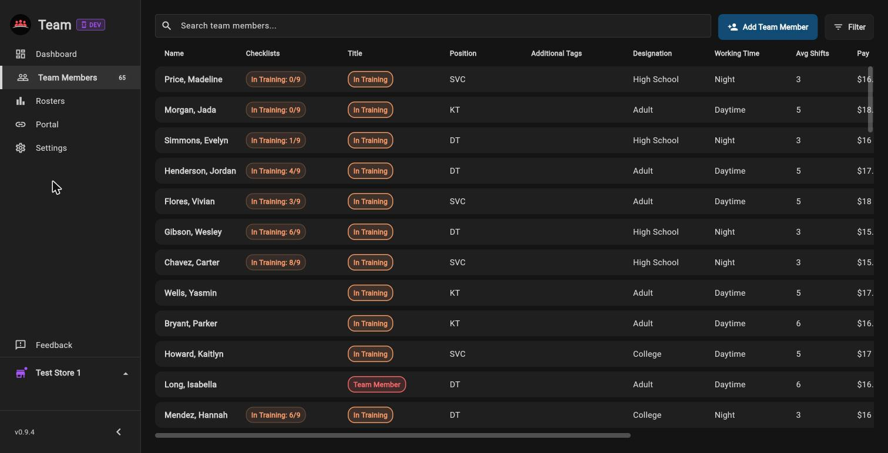
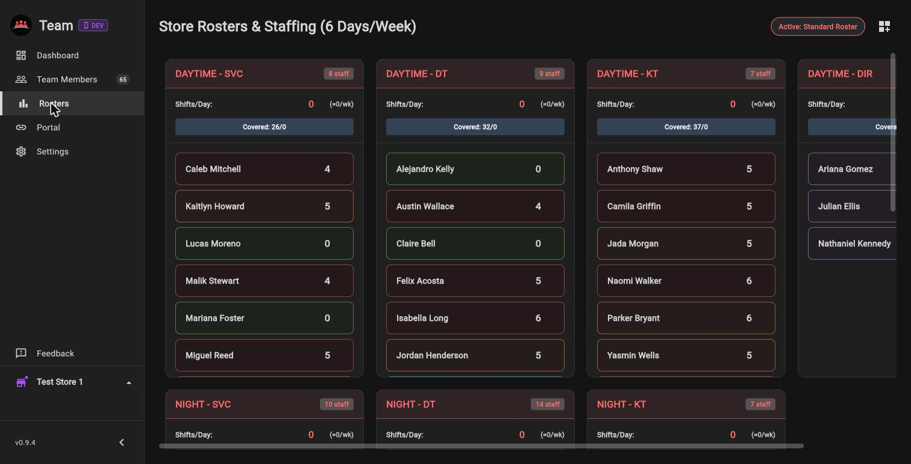

# Axis Optic: Team — Scheduling & Shift Operations

A scheduling and shift-operations platform for quick-service restaurants, built with Flutter and Firebase. Leaders build the week's schedule, run the shift and track training, and team members see their schedule and shifts on their phones.

**Live site:** [team.axisoptic.com](https://team.axisoptic.com) (invite only)

## Overview

Axis Team handles a restaurant's people operations in one place. The web app is for owners and leaders: building schedules from templates, managing the roster, running shift boards and following each person's training and promotions. The same codebase runs as a phone app for team members, showing their schedule, the shift board and their progress. Several stores can be run from one login.

| Team members | Rosters and staffing |
| --- | --- |
|  |  |

Screenshots show a test store filled with made-up sample data.

## Features

- **Schedule builder.** Weekly schedules built from per-day templates of positions and time slots, with a coverage strip showing where the day is short or overstaffed.
- **Automatic scheduling.** A local algorithm fills the week from availability, time off, labor rules (rest gaps, curfews for minors, days in a row) and each person's habits. An optional CP-SAT solver (Google OR-Tools) finds an optimal schedule, and the app keeps whichever covers more.
- **AI instructions.** Managers can type requests like "Jordan needs 1 hour of admin after his truck shift" and the schedule is reworked around them, using the Gemini API.
- **Roster and team.** Titles, tags, areas, availability, time off requests and member details, with access levels for each leader.
- **Shift boards.** A live board of who is on which position, with a customizable layout.
- **Training and title journeys.** Training reviews and checklists for new hires, and a path of titles each person works through. Promotions send the team member a push notification and a congratulations screen.
- **Team member app.** My schedule, the shift board, the roster and the person's own journey, on Android and iOS.
- **Multiple stores.** Owners switch between stores and see each one's team at a glance.
- **Store export.** Download a store's whole setup and team as a spreadsheet.
- **Feedback.** Bug reports and ideas go to the developers' inbox, with replies sent back to the person.

## Built with

- [Flutter](https://flutter.dev) (Dart) for web, Android and iOS, with Riverpod and go_router
- Firebase: Authentication, Cloud Firestore, Cloud Messaging, Cloud Functions (Node.js) and Hosting
- Python, FastAPI and Google OR-Tools (CP-SAT) for the optional scheduling backend
- Google Gemini API, for the AI scheduling instructions

## Project structure

```
lib/
  main.dart            app entry point
  core/                router, theme, version, staffing calculator
  models/              data classes (users, schedules, store settings, title journeys)
  providers/           Riverpod state
  services/            Firestore, push notifications, store export, sample data
  ui/views/            web screens (dashboard, schedule, rosters, settings, ...)
  ui/views/schedule/   schedule engine, AI scheduler, templates, shift dialogs
  ui/mobile/           team member phone app
  ui/widgets/          shared widgets
functions/
  index.js             Cloud Functions: scheduled push notifications, feedback, account email changes
backend/               CP-SAT scheduling service (FastAPI), see backend/README.md
tools/store_intros/    builds the sign-in blueprint animations
test/                  widget and unit tests
```

## Running locally

The Firebase config in this repository is a placeholder, so the app needs a Firebase project of your own:

1. Install the [Flutter SDK](https://docs.flutter.dev/get-started/install).
2. Create a Firebase project and run `flutterfire configure` to replace `lib/firebase_options.dart` and generate the platform config files.
3. Run `flutter pub get`, then `flutter run -d chrome`.
4. To use the AI instructions, pass your own key: `flutter run -d chrome --dart-define=GEMINI_API_KEY=your_key`. No key is included in the repository.

The scheduling backend is optional. See [backend/README.md](backend/README.md) to run it, and build the app with `--dart-define=SCHEDULE_BACKEND_URL=...` to use it.

## Deployment

```bash
flutter build web --release
firebase deploy --only hosting
firebase deploy --only functions
```

The Cloud Functions read the developer logins from `functions/.env`, which is not in the repository (see `functions/.env.example`). On macOS you can also double-click `deploy_team_website.command` or `deploy_notifications.command`.

## How it was built

This project was built with AI-assisted development. I designed the app and directed the work, and I used **Claude** (Anthropic) and **Gemini** in **Google Antigravity** to write and iterate on the code. The commit history was rebuilt from dated snapshots of the project, so it shows how the app changed over time.

All names, stores and schedules in the sample data and tests are made up.

## Status

**Current version: 0.9.5.** In active development. See the [changelog](CHANGELOG.md) for version history.

## License

The source code is available under the [MIT License](LICENSE). The Axis Optic and Axis Team names, logos and product designs are not covered by the license and may not be reused.
